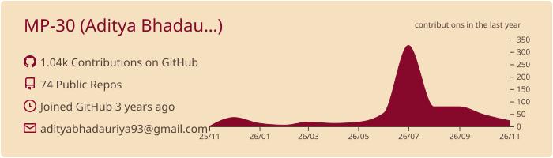
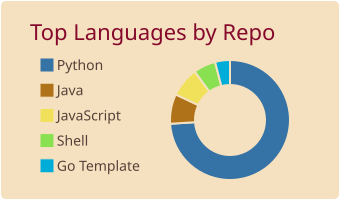
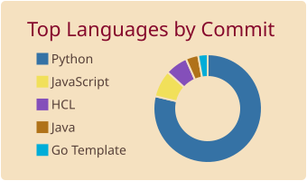
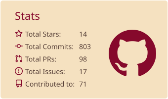
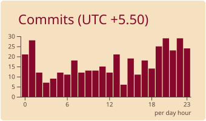

<p align="center">
  <picture>
    <source media="(prefers-color-scheme: dark)" srcset="https://capsule-render.vercel.app/api?type=waving&height=230&section=header&color=0%3A991B1B%2C50%3AB4472F%2C100%3AD9775C&fontColor=FFFFFF&descColor=FDE2DA&text=Aditya%20Bhadauriya&fontSize=50&fontAlignY=35&desc=Python%20AI%20%26%20Backend%20Engineer%20%7C%20RAG%20%7C%20Platform%20Engineering&descSize=18&descAlignY=55&animation=fadeIn"/>
    
  </picture>
</p>

<p align="center">
  
</p>

<p align="center">
  <a href="https://adityalive.tech/"></a>
  <a href="https://www.linkedin.com/in/aditya-bhadauriya-99bb8a86/"></a>
  <a href="mailto:adityabhadauriya93@gmail.com"></a>
  <a href="https://adityalive.tech/assets/resume.pdf"></a>
  
</p>


## About Me

I'm **Aditya Bhadauriya**, a Python AI and backend engineer who builds, evaluates and deploys LLM systems. I've shipped RAG and agent services on **AWS Bedrock** for a healthcare document assistant, a banking GRC platform and a live multi-tenant RAG platform, the last with an evaluation suite that gates its CI. I have **4 years** of experience building FastAPI and Django services for fintech and enterprise clients, including the deployment and monitoring side. I moved into software from an electrical engineering career.

```yaml
apiVersion: engineer/v1
kind: Profile
metadata:
  name: aditya-bhadauriya
  labels:
    role: python-ai-backend-engineer
    focus: rag-agents-platform
spec:
  experience: "4 years"
  expertise:
    - RAG, hybrid retrieval & RAGAS evals
    - Agents & MCP (AWS Strands, Pydantic AI)
    - AWS Bedrock, pgvector, PostgreSQL
    - FastAPI, Django, Celery, async pipelines
    - AWS (ECS Fargate, EKS, Lambda, SQS/SNS, S3, IAM)
    - Infrastructure as Code (Terraform)
    - CI/CD (GitHub Actions + OIDC, Jenkins)
    - Observability (Datadog, OpenTelemetry, Prometheus, Grafana)
  learning:
    - Multi-agent orchestration (A2A)
    - LLM observability
    - Distributed Systems
  building: Academic Intelligence Platform (RAG + MCP on AWS)
```


## Featured Projects

<table>
  <tr>
    <td width="33%" valign="top">
      <h3><a href="https://github.com/MP-30/Academic-Intelligence-Platform">Academic Intelligence Platform</a></h3>
      <p>Live multi-tenant RAG platform answering over CBSE curriculum PDFs with page-level citations. Hybrid retrieval (pgvector + full-text, fused with RRF), an AWS Strands agent that routes between private documents and live web search, and tools exposed as MCP servers in sidecar containers.</p>
      
      
      
      
      
    </td>
    <td width="33%" valign="top">
      <h3><a href="https://github.com/MP-30/academic-intelligence-platform-terraform">Academic Intelligence Platform: Terraform</a></h3>
      <p>Infrastructure-as-code for the platform: VPC, private RDS, ECS Fargate, ALB and Cognito. Paired with GitHub Actions OIDC deploys, so there are no stored AWS credentials. Runs at about $48/month.</p>
      
      
      
    </td>
    <td width="33%" valign="top">
      <h3><a href="https://github.com/MP-30/AI-assisted-Linux-debugging">AI-assisted Linux Debugging</a></h3>
      <p>FastAPI service and CLI that snapshots a Linux host's health and uses runbook retrieval with a local LLM to suggest root causes and fixes.</p>
      
      
      
      
    </td>
  </tr>
  <tr>
    <td width="33%" valign="top">
      <h3><a href="https://github.com/MP-30/hyper-scale-ops">Hyper Scale Ops</a></h3>
      <p>End-to-end Python application, containerized and shipped through Jenkins and GitHub Actions to Kubernetes with Datadog monitoring.</p>
      
      
      
      
    </td>
    <td width="33%" valign="top">
      <h3><a href="https://github.com/MP-30/hyper-scale-ops-k8s">Hyper Scale Ops Helm Charts</a></h3>
      <p>Helm chart repository used to deploy Hyper Scale Ops onto Kubernetes clusters.</p>
      
      
    </td>
    <td width="33%" valign="top">
      <h3><a href="https://github.com/frappe/frappe/pull/33680">Open Source: Frappe Framework</a></h3>
      <p>Fixed phone-number validation in the Address doctype; merged into Frappe's version-15-hotfix (PR #33680) and released in v15.78.0.</p>
      
      
    </td>
  </tr>
</table>

<p align="center">
  <a href="https://ai.adityalive.tech"></a>
  <a href="https://dev.adityalive.tech/"></a>
  <a href="https://p.us5.datadoghq.com/sb/8e9bd3b1-7001-11f1-aae3-c2753782a27a-994485ddc16ff7de20d382368a9bf932"></a>
</p>

### Highlights from the Academic Intelligence Platform

- **Verifiable answers:** page-aware chunking (600 tokens / 100 overlap) keeps exact page numbers, so every answer cites the PDF page it came from.
- **Evals that gate CI:** a RAGAS suite runs against the production `/agent` endpoint nightly and fails on a 0.05 regression. It exposed that `/agent` wasn't returning retrieved chunks, which made faithfulness a self-comparison, and an 11-turn smoke test later caught 20× response bloat that the single-turn eval missed.
- **Tenant isolation at the SQL layer:** verified in CI, where cross-tenant queries return 0 rows.
- **Async ingestion:** S3 → SQS → ECS Fargate worker with retries and a dead-letter queue.
- **Zero stored AWS credentials:** GitHub Actions deploys through OIDC (about 4 minutes including the health check).


## Tech Stack

<div align="center">

### AI & LLM


### Software Engineering

<picture>
  <source media="(prefers-color-scheme: dark)" srcset="https://skillicons.dev/icons?i=python%2Cfastapi%2Cdjango%2Cpostgres%2Credis%2Cbash&perline=6&theme=dark"/>
  
</picture>

<p>
  
  
  
</p>

### Cloud & DevOps

<picture>
  <source media="(prefers-color-scheme: dark)" srcset="https://skillicons.dev/icons?i=aws%2Cdocker%2Ckubernetes%2Cterraform%2Cjenkins%2Cgithubactions%2Clinux&perline=7&theme=dark"/>
  
</picture>

<p>
  
  
  
</p>

### Observability


### Tools

<picture>
  <source media="(prefers-color-scheme: dark)" srcset="https://skillicons.dev/icons?i=git%2Cgithub%2Cvscode%2Cpostman%2Cpycharm&perline=5&theme=dark"/>
  
</picture>

</div>


## GitHub Activity

<p align="center">
  <picture>
    <source media="(prefers-color-scheme: dark)" srcset="https://raw.githubusercontent.com/MP-30/MP-30/output/cards/kacho_ga/0-profile-details.svg"/>
    
  </picture>
</p>

<p align="center">
  <picture>
    <source media="(prefers-color-scheme: dark)" srcset="https://raw.githubusercontent.com/MP-30/MP-30/output/cards/kacho_ga/1-repos-per-language.svg"/>
    
  </picture>
  <picture>
    <source media="(prefers-color-scheme: dark)" srcset="https://raw.githubusercontent.com/MP-30/MP-30/output/cards/kacho_ga/2-most-commit-language.svg"/>
    
  </picture>
</p>

<p align="center">
  <picture>
    <source media="(prefers-color-scheme: dark)" srcset="https://raw.githubusercontent.com/MP-30/MP-30/output/cards/kacho_ga/3-stats.svg"/>
    
  </picture>
  <picture>
    <source media="(prefers-color-scheme: dark)" srcset="https://raw.githubusercontent.com/MP-30/MP-30/output/cards/kacho_ga/4-productive-time.svg"/>
    
  </picture>
</p>

<p align="center">
  <picture>
    <source media="(prefers-color-scheme: dark)" srcset="https://github-readme-streak-stats-eight.vercel.app/?user=MP-30&theme=dark&hide_border=true&ring=D9775C&fire=D9775C&currStreakLabel=D9775C"/>
    
  </picture>
</p>

<p align="center">
  <picture>
    <source media="(prefers-color-scheme: dark)" srcset="https://raw.githubusercontent.com/MP-30/MP-30/output/github-snake-dark.svg"/>
    
  </picture>
</p>


## Let's Connect

<p align="center">
  <a href="https://adityalive.tech/"></a>
  <a href="https://github.com/MP-30"></a>
  <a href="https://www.linkedin.com/in/aditya-bhadauriya-99bb8a86/"></a>
  <a href="mailto:adityabhadauriya93@gmail.com"></a>
  <a href="https://leetcode.com/mp-30"></a>
</p>

<p align="center">
  <picture>
    <source media="(prefers-color-scheme: dark)" srcset="https://capsule-render.vercel.app/api?type=waving&height=120&section=footer&color=0%3AD9775C%2C50%3AB4472F%2C100%3A991B1B"/>
    
  </picture>
</p>
